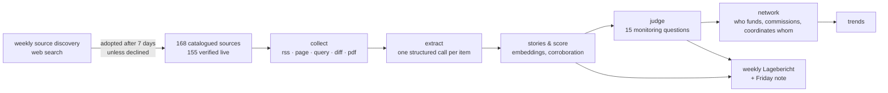

# Horizont-Scanner Landkreis Miesbach

A horizon scanner for **social provision in Landkreis Miesbach** (Upper Bavaria), built for
Caritas-Zentrum Miesbach within the TUM Think Tank **Strategic Foresight Clinic** (Edition 01,
Team 1).

> **Kurz auf Deutsch.** Der Scanner liest jeden Tag rund 150 öffentliche Quellen – Gemeinden,
> Landkreis, Wohlfahrtsverbände, Kirche, Bezirk, Freistaat, Bund, Lokalpresse, Vergleichsfälle –
> und verdichtet, was sich bei Mandaten, Geld, Personal, Regeln und Legitimität rund um die
> soziale Versorgung bewegt. Jede Woche entsteht ein Lagebericht mit einer kurzen Notiz an das
> Caritas-Zentrum. Alles, was der Scanner behauptet, ist mit der Quelle belegt.

## Why it exists

The project behind it asks one question: *how can an inter-municipal structure for social
provision — the "Interkommunale Sozialraumlotsen" — be designed and anchored so that it still
works in 2035 and 2040?*

The deep-research brief behind the scanner found that the county already has many *named*
coordination structures (a Sozialbeirat, several networks, a GesundheitsregionPlus in the
making). The open question is whether they connect, hold decision rights, keep their people
and move information. So the scanner does not collect general local news. It watches for
change in **mandates, money, staffing, rules and legitimacy**, and it reads every signal
against fifteen standing monitoring questions taken from that brief.

## What it does



- **Nine layers.** Gemeinden · Landkreis & Dienste · Wohlfahrt & Zivilgesellschaft · Kirche ·
  Bezirk Oberbayern · Freistaat Bayern · Bund · Medien & Forschung · Vergleichsfälle.
- **A verified catalogue.** `data/sources.yaml` lists 168 sources, covering all 17
  municipalities. Only sources that passed a live check (`scripts/check_sources.py` →
  `data/sources-live.json`) are ever collected; everything else stays in the catalogue with the
  reason it is not collected.
- **Five collection methods.** RSS/Atom feeds; list pages; Google News searches per
  municipality and theme; *diffs* of structural pages (the change itself is the item); and the
  text of PDFs linked from council and finance pages.
- **Extraction.** One structured model call per item: headline and summary in German and
  English, signal type, topics from a fixed 33-tag vocabulary, places, organisations, forums,
  programmes and offices, events and deadlines, and relations between actors with the quote
  that states them. Persons are never entities; offices are.
- **Stories and score.** The same development reported by several outlets counts once, with
  corroboration. Score = authority × regional relevance × novelty × consequence × forward lag.
- **Fifteen monitoring questions** (`data/questions.yaml`). Each relevant signal is judged
  *for* or *against* each question it bears on, with a strength and a quote. A weekly balance
  per question decays toward zero when no new evidence arrives.
- **Evidence network.** Seeded from the brief (`data/network.yaml`: edges, standing forums and
  the known gaps, such as the undocumented link between Caritas, the Lotsen project, the county
  and the municipalities), extended only by relations a signal quotes.
- **Calendar.** Deadlines, meetings and watch windows from the brief plus those extracted from
  sources; deadlines are kept separate from event dates.
- **Weekly Lagebericht**, Thursdays 18:00 Europe/Berlin: a lead, movement per question,
  sections per layer, cross-layer chains, a watch list, and the *Freitagsnotiz* — two or three
  plain paragraphs for the team's weekly update to Caritas.
- **Self-updating sources.** Every Monday a web-searching model proposes new sources aimed at
  the coverage gaps. Each candidate is verified live; it is adopted after seven days unless
  someone declines it. Declines are permanent.

Seven views, German by default with an English toggle: **Lage · Fragen · Netz · Lagebericht ·
Signale · Kalender · Quellen**.

## Provenance is enforced in code

The scanner is meant to be trusted by people who will act on it, so nothing a model writes is
taken on faith:

- A judgement is stored only if its quote is a verbatim span of **one** field of that signal's
  source text, at least three words long. The stored quote is the source's own text, with its
  original spelling and punctuation.
- A network edge from a signal must carry that signal and its quote (a database constraint).
- The Lagebericht may cite only signals, events, judgements and questions it was given; a
  validator rejects anything else, and numbers in the Friday note must appear in its input.
- No signal is dated in the future, and undated list-page items whose own stated date is older
  than 60 days are treated as archive, not news.
- Model IDs live only in `backend/mhs/config.py` and are checked against the live model list
  (`scripts/check_models.py`) before they change.

## Stack

FastAPI · SQLAlchemy 2 (async) · PostgreSQL with pgvector · Alembic · APScheduler · fastembed
(multilingual MiniLM) · Anthropic API with structured outputs (Claude Haiku 5.5 for extraction,
Sonnet 5.5 for judging and source discovery with web search, Opus 5.5 for the Lagebericht) ·
React 19 · Vite · TypeScript · Tailwind CSS v4 · d3-force.

Without an `ANTHROPIC_API_KEY` the whole pipeline runs on a deterministic mock (keyword
vocabulary and entity dictionary) and the interface shows a **Mock** badge.

## Running it locally

```bash
docker compose up -d                                   # Postgres with pgvector on :5441
cd backend
python3.12 -m venv .venv && .venv/bin/pip install -e ".[test]"
cp .env.example .env                                   # add ANTHROPIC_API_KEY for live mode
.venv/bin/alembic upgrade head
.venv/bin/python scripts/check_sources.py              # verify the catalogue live
.venv/bin/python scripts/load_sources.py               # sources, entities, network, calendar, questions
.venv/bin/python scripts/run_cycle.py                  # one daily cycle
.venv/bin/python scripts/run_cycle.py --report         # write the weekly Lagebericht
.venv/bin/uvicorn mhs.main:app --reload --port 8471    # API and the built interface
cd ../frontend && npm install && npm run dev           # dev server on :3001, proxies /api
```

Environment (`backend/.env`, see `.env.example`): `DATABASE_URL`, `ANTHROPIC_API_KEY`,
`APP_PASSWORD`, `SECRET_KEY`, `SCHEDULER_ENABLED`, `CYCLE_HOUR_UTC`, optionally
`MAX_EXTRACTIONS_PER_CYCLE`.

## Tests

```bash
cd backend && .venv/bin/python -m pytest -q            # needs the local Postgres on :5441
cd frontend && npm run build && npx oxlint
```

The suite (339 tests) builds its own database and always runs in mock mode: a key in
`backend/.env` cannot switch it live, so tests never cost money. Most tests name the plausible
wrong implementation they guard against.

## Deploying

The reference deployment runs on Railway: a `web` service built from the `Dockerfile` (Vite
build, then Python with the embedding model baked in) and a `pgvector/pgvector:pg16` Postgres
with a volume. At start, `backend/scripts/start.sh` runs Alembic, loads the catalogue
idempotently and starts uvicorn. Set `APP_PASSWORD`, `SECRET_KEY` and `ANTHROPIC_API_KEY` on
the service; never commit them. Schema changes after the first deployment need their own
Alembic migration (`0002` onward).

## Repository layout

```
backend/mhs/        collect · extract · analyse · questions · network · report · suggest · api
backend/scripts/    check_sources · load_sources · run_cycle · check_models · start.sh
backend/tests/      pytest suite (mock mode)
data/               sources, entities, questions, network, calendar (the domain, as data)
frontend/src/       the seven views
docs/superpowers/   design spec and implementation plan
```

## Status and limits

Built in October 2026 for the Clinic's first edition. Known limits: several municipal council
information systems are script-only and cannot be read directly; some provider websites block
automated reading; the network still collects some generic actors ("Kommunen"); the question
judge is deliberately conservative. The deep-research brief the catalogue and questions were
built from is not part of this repository.

---

Built by Nicklas Berild Lundblad for the TUM Think Tank Strategic Foresight Clinic, with the
Caritas Miesbach team.
