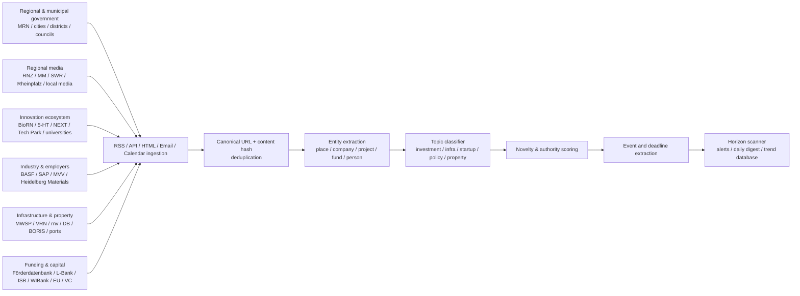

# Rhein-Neckar Horizon-Scanning Source Map

## Executive summary

The Rhein-Neckar information environment is unusually well suited to a structured horizon scanner because a substantial share of the most valuable signals come from **primary institutions that publish machine-readable feeds, structured newsrooms, meeting documents, or recurring newsletters**. The core regional organizations—the Verband Region Rhein-Neckar, Zukunft Metropolregion Rhein-Neckar e.V., and Metropolregion Rhein-Neckar GmbH—operate as the region's three institutional pillars, while the regional strategy explicitly covers energy, hydrogen, carbon capture, mobility, digital infrastructure, innovation, startups, venture capital, workforce, and administrative modernization. citeturn16search6turn16search8turn16search3

For a horizon scanner, I would not treat “regional news” as one stream. The strongest design is a **multi-layer collection system**:

1. **Primary policy and public-sector layer:** MRN/VRRN, municipal pressrooms, council/committee systems, public notices, economic-development agencies and state funding institutions.
2. **Editorial detection layer:** Rhein-Neckar-Zeitung, Mannheimer Morgen, SWR, Wochenblatt Reporter, RNF and specialist real-estate/startup media.
3. **Innovation and cluster layer:** BioRN, 5-HT, Technology Park Heidelberg, NEXT MANNHEIM, KI-Garage, hei_INNOVATION, Health + Life Science Alliance and BioMed X.
4. **Corporate-investment layer:** BASF Ludwigshafen, SAP, Heidelberg Materials, MVV and sector associations.
5. **Infrastructure and property layer:** MWSP, Heidelberg conversion projects, VRN/rnv, Deutsche Bahn, Autobahn GmbH, ports, MRN's real-estate market reporting and the three state BORIS systems.
6. **Funding and capital layer:** Förderdatabank, L-Bank, ISB, WIBank, EFRE Baden-Württemberg, CORDIS/EIC, EXIST, ZIM, KfW, HTGF and regional business angels.

Several unusually useful feeds already exist. Mannheim exposes municipal press information through RSS; Heidelberg has an extensive official RSS directory covering press releases, construction sites, council news, economic affairs and events; RNZ and Mannheimer Morgen provide multiple granular geographic and economic feeds; Heidelberg University, DKFZ, EMBL, BioMed X, SAP, Heidelberg Materials, MVV, the federal Förderdatabank and the EIC expose machine-readable feeds. citeturn21search0turn22view0turn19search0turn19search6turn7search0turn7search3turn17search0turn18search10turn8search1turn8search2turn8search3turn9search0turn10search1

The biggest blind spot is **not lack of information but fragmentation**. Rhein-Neckar spans institutions operating in Baden-Württemberg, Rheinland-Pfalz and Hessen, so a scanner limited to the three large cities, one newspaper or one state funding portal will systematically miss investment decisions, industrial restructuring, permitting, grants and infrastructure developments. The Bergstraße economic-development agency alone, for example, regularly publishes company investments, broadband deployment, startup support and state/EU funding information relevant to the northern part of the region. citeturn16search0turn16search4

My recommended initial production set is approximately **35 high-signal sources**, with another 30–40 sources kept as thematic or secondary monitors. RSS/API sources should be ingested directly; structured web pages should be change-monitored; email newsletters should be routed into an ingestion mailbox; and social accounts should principally be used as *early-warning pointers* back to authoritative primary material.

## Coverage model and assessment method

The catalogue below uses these authority ratings:

**High — primary/authoritative:** government body, statutory chamber, university/research institution, infrastructure operator, company publishing its own investments, official funding agency, or long-established professional newsroom reporting directly on the area.

**Medium — reliable but secondary or interested party:** trade association, commercial property publication, regional aggregator, ecosystem organization reporting partly on members, or other source whose material is valuable but should ideally be corroborated for consequential claims.

**Low — lead-generation only:** unverified aggregators, anonymous/user-generated sources or purely social chatter. I found little reason to make such sources part of the core Rhein-Neckar collection; the scanner will be stronger if low-authority social material is used only for discovery.

“Frequency” below is an **observed/typical publishing cadence rather than a contractual schedule**. “No RSS found” means I did not identify a current feed in this research; it should not be read as proof that no undocumented endpoint exists. A few official sites explicitly advertise RSS without exposing the endpoint cleanly to the crawler; those are marked **site-linked RSS**.

The geographic model should include the three metropolitan cores—Mannheim, Heidelberg and Ludwigshafen—plus the surrounding Rhein-Neckar, Bergstraße, Pfalz and Odenwald areas. This matters because the regional institutions themselves coordinate public administration, business, research and infrastructure across the wider metropolitan area rather than treating the three core cities in isolation. citeturn16search3turn16search6

## Core regional, government and media sources

| Source | URL | RSS / API | Type / scope | Primary topics | Lang. / cadence | Authority | Access / monitoring notes |
|---|---|---|---|---|---|---|---|
| **Metropolregion Rhein-Neckar portal / MRN GmbH** citeturn16search3turn16search6turn16search8 | `https://m-r-n.com/` | No general feed verified | Government/economic development; **region** | Regional strategy, investment, innovation, mobility, energy, hydrogen, CCS, digital infrastructure, workforce, real estate, events | DE; several updates/month to weekly | **High — primary regional-development body** | Free. Page monitor News/Events, strategy and project sections; subscribe to MRN newsletter. |
| **Verband Region Rhein-Neckar / VRRN** citeturn0search0turn0search5 | `https://m-r-n.com/` → Region & Organisation → Verband | Structured meeting-information system | Government; **region** | Regional planning, land use, transport, committees, budgets, policy decisions | DE; meeting-driven | **High — statutory regional authority** | **Critical scanner source.** Collect agendas, submissions, resolutions and minutes before and after committee meetings. |
| **VRRN committees / citizen information system** citeturn0search1turn0search5turn0search9 | Linked from MRN/VRRN portal | Structured agenda/document pages | Government; **region** | Upcoming political decisions, planning, transport, economic development | DE; according to meeting calendar | **High — primary decision documents** | Page/API-style polling where legally/technically feasible; alert on new agenda items and attachments. |
| **MRN News, Events and regional announcements** citeturn0search8turn5search4turn5search9 | `https://m-r-n.com/` | Newsletter; no universal RSS verified | Government/economic development; **region** | Smart Region, digitalization, projects, conferences, partnerships | DE; weekly/event-driven | **High — primary regional source** | Monitor event and news listing plus newsletter. |
| **MRN Cluster Energie & Umwelt** citeturn16search2 | `https://m-r-n.com/themen-projekte/cluster-energie-umwelt/` | — | Cluster; **region** | Energy, efficiency, hydrogen, bioeconomy, circular economy, sustainable construction, mobility | DE; irregular/project-driven | **High for cluster activity — official MRN cluster** | Excellent source for projects that may later become infrastructure/investment signals. |
| **MRN digital / Smart Region activities** citeturn5search0turn5search4 | `https://m-r-n.com/` | — | Government/network; **region** | Municipal digitalization, data, smart region, public-sector technology | DE; irregular | **High — official regional network** | Monitor project and event pages; useful precursor signal for procurement/digital infrastructure. |
| **Stadt Mannheim — press releases** citeturn21search0turn21search4turn21search8 | `https://www.mannheim.de/de/presse` | **`https://www.mannheim.de/de/rss/pressemeldungen`** | Government; **city** | Policy, construction, transport, development, business, grants, public services | DE; **daily** | **High — primary municipal source** | Free RSS. One of the highest-priority feeds. |
| **Stadt Mannheim — RSS directory** citeturn21search4 | `https://www.mannheim.de/de/rss-feeds` | Official feeds for press, news and events | Government; **city** | Municipal news and event calendar | DE; daily | **High — primary** | Use directory to discover/validate endpoints rather than scraping the homepage. |
| **Mannheim Wirtschaftsförderung — Fakten & Faktoren** citeturn1search0 | `https://www.mannheim.de/de/wirtschaft-entwickeln/wirtschaftsfoerderung/newsletter` | Email newsletter | Government/economic development; **city** | Investments, openings, companies, policy, funding, economic events | DE; **monthly** | **High — primary economic-development source** | Parse newsletter email into scanner; valuable for signals that may not appear in general city press feed. |
| **Mannheim public notices / planning / procurement pages** citeturn21search12 | `https://www.mannheim.de/de/wirtschaft-entwickeln/oeffentliche-bekanntmachungen-aktuelle-planverfahren-vergaben/oeffentliche-bekanntmachungen` | — | Government; **city** | Planning procedures, statutory notices, tenders | DE; event-driven | **High — primary legal/administrative source** | HTML change detection; often earlier signal than newspaper coverage. |
| **Stadt Heidelberg — RSS directory** citeturn22view0turn21search1 | `https://www.heidelberg.de/HD/service/RSS.html` | Multiple official RSS feeds | Government; **city** | Press, economy, council, construction, Bahnstadt, environment, digital, events | DE; daily/event-driven | **High — primary** | One of the richest municipal machine-readable source sets in the region. |
| **Heidelberg — all municipal press releases** citeturn23view0 | `https://www.heidelberg.de/` | **`https://www.heidelberg.de/site/Heidelberg2021/pmrss/407657/Lde/pressemitteilungen.html`** | Government; **city** | Policy, infrastructure, development, municipal decisions | DE; daily | **High — primary** | Endpoint returned as `application/rss+xml`; ingest directly. |
| **Heidelberg — Gemeinderat feed** citeturn22view0turn23view2 | `https://www.heidelberg.de/` | **`https://www.heidelberg.de/site/Heidelberg2021/pmrss/1219308/feed.xml`** | Government; **city** | City council, resolutions, political agenda | DE; meeting/event-driven | **High — primary** | Strong leading indicator; combine with council document system. |
| **Heidelberg — Wirtschaft aktuell** citeturn22view0turn23view3 | `https://wirtschaftsfoerderung.heidelberg.de/` | `https://www.heidelberg.de/site/Heidelberg2021/pmrss/35429/Lde/aktuelles.html` | Government/economic development; **city** | Firms, business support, investment, commercial space, startups | DE; irregular-weekly | **High — primary** | Feed endpoint is exposed by the official RSS directory despite HTML-looking suffix. |
| **Heidelberg municipal event calendar** citeturn22view0turn23view4 | `https://www.heidelberg.de/` | `https://www.heidelberg.de/site/Heidelberg2021/zmrss/1097531/Lde/rss.xml` | Government/events; **city** | Public events, policy/community meetings | DE; continuously updated | **High — primary** | Good candidate for calendar/event entity extraction. |
| **Heidelberg Wirtschaftsförderung newsletter** citeturn1search1 | `https://wirtschaftsfoerderung.heidelberg.de/` | Email newsletter | Government/economic development; **city** | Business support, Heidelberg Innovation Park, investments, grants, events | DE; periodic | **High — primary** | Ingest newsletter in addition to economy RSS because content sets need not be identical. |
| **Stadt Ludwigshafen — Aktuelle Meldungen** citeturn21search10turn21search6 | `https://ludwigshafen.de/aktuelles/aktuelle-meldungen` | **Site-linked RSS: Aktuelles** | Government; **city** | Policy, roads, bridges, construction, city services, development | DE; **daily** | **High — primary** | City explicitly provides “RSS Feed: Aktuelles”; collect linked endpoint from site configuration. |
| **Stadt Ludwigshafen — event feed** citeturn21search6 | `https://ludwigshafen.de/` | **Site-linked RSS: Veranstaltungen** | Government/events; **city** | Municipal events | DE; continuous | **High — primary** | Official portal also lists Facebook, Instagram, YouTube, Mastodon, Bluesky and WhatsApp channels. |
| **Stadt Ludwigshafen — Amtsblatt** citeturn21search14 | `https://ludwigshafen.de/buergerservice/amtsblatt` | — | Government; **city** | Formal notices, regulations, public decisions | DE; issue-driven | **High — official publication** | Page/PDF monitor; useful for legal changes not promoted as news. |
| **W.E.G. Ludwigshafen** citeturn1search2 | `https://weg.ludwigshafen.de/` | **Site-linked RSS for “Aktuelles” and “Veranstaltungen”** | Economic development; **city** | Investment, business location, startups, funding, commercial land, real estate, projects | DE; weekly/event-driven | **High — official economic-development company** | Excellent Ludwigshafen business feed; follow both news and event RSS. |
| **Rhein-Neckar-Kreis — press releases** citeturn21search3turn21search11 | `https://www.rhein-neckar-kreis.de/startseite/aktuelles/pressemeldungen.html` | No feed verified | Government; **district** | District policy, roads, health, labor, funding, infrastructure | DE; several/week | **High — primary district source** | HTML page monitor. |
| **Rhein-Neckar-Kreis Wirtschaftsförderung** citeturn1search3turn1search15 | `https://www.rhein-neckar-kreis.de/wirtschaftsfoerderung` | Newsletter | Economic development; **district** | Investor service, funding, innovation, digitalization, clusters, Europe, commercial locations | DE; periodic | **High — primary** | Subscribe to newsletter and monitor archive. |
| **Wirtschaftsregion Bergstraße / WFB** citeturn16search0turn16search4 | `https://www.wirtschaftsregion-bergstrasse.de/neuigkeiten` | No RSS verified | Economic development; **district / regional, Hessen** | Company investment, startups, funding, broadband, energy, ESG, commercial development, workforce | DE; **several/week** | **High — official district economic-development source** | Particularly important for Viernheim, Heppenheim, Bensheim and northern MRN. HTML/change monitoring. |

**Regional editorial feeds**

| Source | URL | RSS / API | Type / scope | Primary topics | Lang. / cadence | Authority | Access / monitoring notes |
|---|---|---|---|---|---|---|---|
| **Mannheimer Morgen — Mannheim** citeturn19search9turn2search0 | `https://www.mannheimer-morgen.de/` | **`https://www.mannheimer-morgen.de/feed/117-rss-mannheim.xml`** | Media; **city** | City politics, development, transport, companies, society | DE; daily/intraday | **High — established regional newsroom** | Some article access may require subscription; feed useful even where full text is restricted. |
| **Mannheimer Morgen — Rhein-Main-Neckar** citeturn19search6turn2search4 | `https://www.mannheimer-morgen.de/` | **`https://www.mannheimer-morgen.de/feed/65-rss-rhein-main-neckar.xml`** | Media; **region** | Regional news, surrounding municipalities, infrastructure | DE; daily | **High — established regional newsroom** | Core discovery feed. |
| **Mannheimer Morgen — Wirtschaft** citeturn2search8 | `https://www.mannheimer-morgen.de/` | **`https://www.mannheimer-morgen.de/feed/56-wirtschaft-rss-feed.xml`** | Media; regional/national | Companies, economy, labor, investment | DE; daily | **High — professional newsroom** | Pair with regional feed and deduplicate. |
| **Mannheimer Morgen — Unternehmen der Region** citeturn2search12 | `https://www.mannheimer-morgen.de/` | **`https://www.mannheimer-morgen.de/feed/59-rss-feed-unternehmen-der-region.xml`** | Media; **region** | Corporate investment, earnings, jobs, restructuring | DE; daily/irregular | **High — highly targeted editorial source** | **Especially valuable for the requested horizon scanner.** |
| **Rhein-Neckar-Zeitung — RSS directory** citeturn19search0turn19search11 | `https://www.rnz.de/rss-feeds.html` | 12+ topic/geographic feeds | Media; **region** | Heidelberg, Rhein-Neckar-Kreis, Mannheim, economy, SW Germany | DE; daily/intraday | **High — established regional newspaper** | RNZ+ paywall applies to part of the site; RSS directory itself is open. |
| **RNZ — Heidelberg** citeturn4view0 | `https://www.rnz.de/` | **`https://www.rnz.de/feed/139-RL_Heidelberg_free.xml`** | Media; **city** | Policy, construction, property, business, research | DE; daily | **High — regional newsroom** | Free-feed endpoint; full articles may be RNZ+. |
| **RNZ — Rhein-Neckar** citeturn4view1turn19search8 | `https://www.rnz.de/region/region-hd.html` | **`https://www.rnz.de/feed/142-RL_Rhein-Neckar_free.xml`** | Media; **district/region** | Municipal developments, real estate, business, infrastructure | DE; daily | **High — regional newsroom** | Important for smaller municipalities that large-city feeds miss. |
| **RNZ — Metropolregion & Mannheim** citeturn4view2 | `https://www.rnz.de/` | **`https://www.rnz.de/feed/151-RL_metropolregion-mannheim_free.xml`** | Media; **region** | Mannheim and metropolitan-region news | DE; daily | **High** | Pair with MM feeds; good cross-editorial corroboration. |
| **RNZ — Wirtschaft Regional** citeturn4view3turn19search0 | `https://www.rnz.de/` | **`https://www.rnz.de/feed/160-RL_Wirtschaft_regional_free.xml`** | Media; **region** | Companies, investment, labor, economic policy | DE; daily | **High — targeted editorial source** | A top-tier scanner feed. |
| **SWR Aktuell — Mannheim/Ludwigshafen studio** citeturn2search19 | `https://www.swr.de/swraktuell/baden-wuerttemberg/mannheim/index.html` | No regional RSS confirmed | Public media; **region** | Breaking regional news, transport, politics, economy | DE; daily/intraday | **High — public broadcaster with local newsroom** | Page-monitor region page. Particularly useful for breaking infrastructure incidents. |
| **SWR general news feed** citeturn19search2 | `https://www.swr.de/` | `https://www.swr.de/~rss/index.xml` | Public media; BW/RP | State/regional news | DE; intraday | **High content authority** | Feed URL surfaced by a third-party RSS directory rather than an SWR feed directory in this research; **validate endpoint before production deployment**. |
| **Wochenblatt Reporter — general RSS** citeturn19search1 | `https://www.wochenblatt-reporter.de/` | **`https://www.wochenblatt-reporter.de/rss`** | Media/community; **Pfalz + parts of region** | Local developments, business, roads, politics, events | DE; intraday | **Medium — useful local secondary source** | Free. High recall, lower precision; entity/location filters are essential. |
| **Wochenblatt Reporter — Speyer** citeturn19search3 | `https://www.wochenblatt-reporter.de/speyer` | **`https://www.wochenblatt-reporter.de/speyer/rss`** | Media; **city** | Local economy, development, infrastructure, politics | DE; daily | **Medium** | Local RSS pattern is useful for location-specific ingestion. |
| **MRN-News** citeturn19search12turn0search6 | `https://www.mrn-news.de/` | No feed endpoint verified | Digital media/aggregator; **region** | Very high-volume local news, public safety, municipal announcements, companies | DE; intraday | **Medium — fast but secondary/heterogeneous** | Good event detector. Do not let police/incident volume swamp economic signals; topic weighting needed. |
| **Rhein-Neckar Fernsehen / RNF** citeturn20search0turn20search1 | `https://www.rnf.de/` | No current RSS verified | Broadcast media; **region** | Local politics, economy, infrastructure, interviews | DE; daily when active | **Medium–High editorial source** | HTML/video page monitoring; current RSS was not identified. |
| **DIE RHEINPFALZ** citeturn2search2turn2search10 | `https://www.rheinpfalz.de/` | No RSS verified | Media; **Pfalz/Rheinland-Pfalz** | Ludwigshafen, Speyer, Frankenthal, Pfalz economy and politics | DE; daily | **High — major regional newspaper** | Significant subscription/paywall component. Use topic newsletters, app and page monitoring. |

## Innovation, academia, clusters, chambers and industry

The region's innovation sources deserve unusually heavy weighting. BioRN's monthly newsletter combines member news, research, financing opportunities and events; MRN has an established Energy & Environment cluster; the Health + Life Science Alliance unites Heidelberg and Mannheim institutions around biomedicine, health and technology transfer; and hei_INNOVATION publishes specific spin-off and funding milestones. citeturn5search2turn16search2turn18search0turn18search9

| Source | URL | RSS / API | Type / scope | Primary topics | Lang. / cadence | Authority | Access / monitoring notes |
|---|---|---|---|---|---|---|---|
| **IHK Rhein-Neckar** citeturn15search0turn15search4 | `https://www.ihk.de/rhein-neckar/presse` | Newsletter; no RSS verified | Chamber / industry; **region** | Economic policy, infrastructure, skills, energy, firms, surveys, startups | DE; weekly/event-driven | **High — statutory chamber / primary for its positions and surveys** | Free; newsletter, LinkedIn, Facebook, Instagram, YouTube. Strong policy-warning source. |
| **IHK Pfalz** citeturn15search1turn15search5 | `https://www.ihk.de/pfalz/servicemarken/presse-und-oeffentlichkeitsarbeit/` | Newsletter / press distribution | Chamber; **Pfalz** | Business climate, infrastructure, taxation, state policy, skills | DE; several/week | **High — statutory chamber** | Newsletter and press list; economic magazine six issues/year. |
| **IHK Darmstadt Rhein Main Neckar** citeturn15search2turn15search6 | `https://www.ihk.de/darmstadt/servicemarken/news/` | **RSS:** `https://www.ihk.de/darmstadt/system/rsscategories/rssactions/rssfeedpressemitteilungen/2529238` | Chamber; **South Hessen** | Bergstraße economy, infrastructure, business climate, innovation | DE; weekly | **High — statutory chamber** | Excellent RSS for Hessian/northern MRN signals. |
| **Handwerkskammer Mannheim Rhein-Neckar-Odenwald** citeturn15search3turn15search7 | `https://www.hwk-mannheim.de/` | No RSS verified | Chamber; **region** | SMEs, construction trades, succession, finance, skills, startups | DE; event-driven | **High — statutory chamber** | Event calendar contains L-Bank/financing, startup/succession and innovation sessions. |
| **BioRN Life Science Cluster Rhine-Neckar** citeturn5search2turn5search6 | `https://biorn.org/newsletter/` | Email newsletter/archive | Cluster/industry; **region** | Biotech, pharma, startups, grants, investment, research, jobs, events | EN/DE; **monthly** | **High for ecosystem intelligence — established regional cluster** | One of the best “weak-signal aggregation” sources. Parse newsletter archive. |
| **5-HT Digital Hub Chemistry & Health** citeturn5search3turn5search11 | `https://www.5-ht.com/media/` | Newsletter; blog | Cluster/incubator; **region** | Chemistry, health, sustainability, startups, digital transformation | DE/EN; irregular | **High for own programs; medium for market-wide claims** | Monitor media/blog and newsletter; also useful for Digital Hub developments. |
| **Technologiepark Heidelberg** citeturn6search0turn6search3 | `https://www.technologiepark-heidelberg.de/aktuelles/` | Newsletter; no RSS verified | Incubator/technology park; **city/region** | Startups, life sciences, technology, investor matching, space, grants, events | DE/EN; weekly/irregular | **High — primary ecosystem operator** | Monitor `/aktuelles/news/`, events and newsletter. |
| **NEXT MANNHEIM** citeturn6search5turn6search2 | `https://next-mannheim.de/` | No RSS verified | Incubator/economic development; **city** | Startups, creative industries, urban innovation, entrepreneurship | DE/EN; weekly/event-driven | **High — city-owned ecosystem operator** | Monitor `https://next-mannheim.de/news/` and events. |
| **MAFINEX** citeturn1search4turn1search8 | `https://mafinex.next-mannheim.de/` | — | Incubator; **city/region** | Tech/IT startups, coworking, investor access, entrepreneurship | DE; irregular | **High — official Mannheim startup infrastructure** | Page/event monitor; signals new tenants and ecosystem activity. |
| **KI-Garage** citeturn6search1 | `https://www.ki-garage.de/` | Newsletter / podcast | Accelerator/academia; **Baden-Württemberg with Heidelberg relevance** | AI startups, transfer, entrepreneurship, funding, programs | DE/EN; periodic | **High for its program activity** | Track cohort/application announcements and startup outcomes. |
| **Life Science Accelerator Baden-Württemberg** citeturn18search3turn18search7 | via `https://www.startupbw.de/` | Start-up BW news page | Accelerator; **state / strong Rhein-Neckar nexus** | Biotech, medtech, digital health, pre-seed/seed startups | DE; cohort-driven | **High — state-backed program** | Joint initiative involving Technologiepark Heidelberg, Heidelberg Startup Partners, MAFINEX network and Mannheim economic development. |
| **PALATINA Business Angels Rhein-Neckar** citeturn24search3turn24search11 | `https://palatina-angels.de/` | No RSS verified | VC/business angels; **region** | Pre-seed/seed financing, pitch events, scaleups, investor matching | DE; event-driven | **Medium–High — primary source for its own deals/network** | Monitor events and portfolio stories; based in Heidelberg Innovation Park. |
| **Start-up BW** citeturn24search0turn24search8 | `https://www.startupbw.de/ueber-the-start-up-laend/news` | No RSS verified | Government/startup; **state** | Accelerators, grants, VC, startup competitions, policy, events | DE; **several/week** | **High — official Baden-Württemberg startup portal** | Page monitor plus official LinkedIn/Instagram; filter for Heidelberg/Mannheim/Rhein-Neckar. |
| **hei_INNOVATION, Heidelberg University** citeturn18search1turn18search5turn18search9 | `https://www.uni-heidelberg.de/en/transfer/heiinnovation` | Covered by University newsroom RSS; dedicated page monitor | Academia/transfer; **city/region** | Spin-offs, EXIST grants, patents, startup hub, commercialization, funding | DE/EN; several/month | **High — university primary source** | **Very high signal:** “Spotlights” reports individual startup funding and spin-off milestones. |
| **Health + Life Science Alliance Heidelberg Mannheim** citeturn18search0turn18search4 | `https://www.health-life-sciences.de/` | No RSS verified | Academia/cluster; **Heidelberg–Mannheim** | Biomedicine, medtech, AI, research infrastructure, technology transfer, industry partnerships | DE/EN; irregular | **High — official research alliance** | Monitor news, calls, platform investments and collaboration announcements. |
| **Heidelberg University Newsroom** citeturn7search0turn7search8 | `https://www.uni-heidelberg.de/en/newsroom` | **`https://backend.uni-heidelberg.de/en/newsroom/3940/all/feed.xml`** | Academia; **city/global research** | Research, grants, institutes, transfer, appointments, partnerships | DE/EN; several/week | **High — primary university source** | Prefer this current feed over the old press RSS, which showed stale material in search. |
| **University of Mannheim press releases** citeturn7search5turn7search1 | `https://www.uni-mannheim.de/newsroom/presse/pressemitteilungen/` | No RSS verified | Academia; **city** | Economics, business, social sciences, AI/data, grants, transfer | DE/EN; several/month | **High — primary university source** | HTML/page monitor. |
| **ZEW Mannheim** citeturn7search2 | `https://www.zew.de/presse` | Email press list; no current RSS verified | Think tank/research; **Mannheim/national/EU** | Economy, innovation, taxation, energy, digitalization, labor, policy | DE/EN; several/week | **High — major economic research institute** | Highly useful context/leading-indicator source; subscribe to press distribution. |
| **DKFZ** citeturn7search3 | `https://www.dkfz.de/` | **`https://www.dkfz.de/feed.rss`** | Academia/research; **Heidelberg/national** | Cancer research, biotech, grants, spin-offs, partnerships | DE/EN; frequent | **High — primary national research center** | Direct RSS; entity-filter for commercialization, awards, grants and company partnerships. |
| **EMBL Heidelberg** citeturn17search0turn17search8 | `https://www.embl.org/` | **`https://www.embl.org/news/embl-taxonomy/embl-heidelberg/feed/`** | Academia/research; **Heidelberg/European** | Life sciences, technology, grants, infrastructure, partnerships | EN; several/week | **High — primary European research organization** | Heidelberg-specific feed avoids irrelevant material from other EMBL sites. |
| **HITS — Heidelberg Institute for Theoretical Studies** citeturn17search9turn17search13turn17search17 | `https://www.h-its.org/` | Email press list; social channels | Academia/think tank; **Heidelberg** | AI, computation, data science, molecular science, grants, research partnerships | DE/EN; several/month | **High — primary research institute** | News, press releases and event calendar; official site also lists Bluesky, LinkedIn, YouTube, Instagram, Facebook and SciLogs. |
| **BioMed X** citeturn18search2turn18search10 | `https://bmedx.com/news-events/press-releases/` | **`https://bmedx.com/news-events/press-releases/feed/`** | Industry/accelerator/research; **Heidelberg/global** | Pharma collaborations, accelerator programs, R&D investment, calls for proposals | EN; monthly/event-driven | **High for own deals — primary issuer** | Excellent RSS for corporate R&D partnerships and accelerator signals. |
| **Chemieverbände Rheinland-Pfalz** citeturn26search0turn26search3turn26search12 | `https://www.chemie-rp.de/newsroom` | Newsletter/social; no RSS verified | Industry association; **Rheinland-Pfalz** | Chemicals/pharma, investment climate, energy, regulation, labor, industrial policy | DE; weekly | **Medium–High — authoritative sector body, advocacy perspective** | Essential because Ludwigshafen's industrial economy is strongly chemistry/pharma exposed; treat policy claims as stakeholder positions. |
| **Bauwirtschaft Baden-Württemberg** citeturn26search5turn26search11turn26search2 | `https://bauwirtschaft-bw.de/` | No RSS verified | Industry association; **state** | Construction, housing, roads, bridges, public investment, regulation | DE; weekly | **Medium–High — sector authority, advocacy perspective** | Monitor for Rhein-Neckar-specific infrastructure statements; has directly addressed Mannheim bridge conditions. |
| **BASF Ludwigshafen — site news** citeturn8search0 | `https://www.basf.com/global/en/who-we-are/organization/locations/europe/german-sites/ludwigshafen/news-and-media/news-releases` | Email/distribution options; no site-specific RSS verified | Industry/employer; **Ludwigshafen** | Capex, plant openings/closures, production, energy, jobs, safety, industrial transformation | DE/EN; event-driven | **High — primary company source** | **Critical employer/investment monitor.** Page-change monitoring recommended. |
| **SAP Germany News Center** citeturn8search1turn8search5turn8search9 | `https://news.sap.com/germany/` | **`https://news.sap.com/germany/feed/`**; press releases: **`https://news.sap.com/germany/type/pressemitteilung/feed/`** | Industry/employer; **Walldorf / national-global** | AI, cloud, investment, jobs, partnerships, startups, enterprise technology | DE; frequent | **High — primary company source** | Official site documents topic-specific `/feed/` behavior. |
| **Heidelberg Materials** citeturn8search2turn8search6 | `https://www.heidelbergmaterials.com/` | Press: **`https://www.heidelbergmaterials.com/en/rss/press-release?lang=en`**; news: **`https://www.heidelbergmaterials.com/en/rss/news`** | Industry/employer; **Heidelberg/global** | Construction materials, decarbonization, CCS, capex, acquisitions | EN; weekly/event-driven | **High — primary company source** | Particularly useful for the MRN CCS/decarbonization theme. |
| **MVV Energie** citeturn8search3turn8search7 | `https://www.mvv.de/` | **`https://www.mvv.de/presse_feed.rss`** | Industry/utility; **Mannheim/region** | Energy infrastructure, district heating, renewables, investment, grid/decarbonization | DE; several/month | **High — primary regional utility** | Core infrastructure feed. |

## Infrastructure, real estate, investment and funding sources

Infrastructure is an area where primary project-owner monitoring can materially outperform newspaper monitoring. Ludwigshafen and Mannheim's bridge/road interfaces, Rhein-Neckar rail projects, public transport and large conversion sites generate long planning cycles in which formal notices, operator releases and political committee documents can precede mainstream reporting. Recent IHK Rhein-Neckar material, for example, explicitly discusses rail expansion and Rhine-crossing infrastructure, illustrating how economic and transport signals overlap. citeturn15search4turn15search5

The regional property market also has unusually good official data. MRN publishes an annual Rhein-Neckar real-estate market report covering investment, offices, retail and commercial sites, while Baden-Württemberg, Rheinland-Pfalz and Hessen each provide official land-value systems. citeturn25search6turn14search2turn25search0turn25search1

**Infrastructure and property**

| Source | URL | RSS / API | Type / scope | Primary topics | Lang. / cadence | Authority | Access / monitoring notes |
|---|---|---|---|---|---|---|---|
| **MWSP Mannheim** citeturn12search4turn12search0 | `https://www.mwsp-mannheim.de/` | Newsletter; no RSS verified | Government/real estate; **Mannheim** | Conversion, FRANKLIN, brownfields, plots, urban development, investors | DE; monthly/event-driven | **High — city development/conversion company** | Monitor news, project milestones and available plots. |
| **FRANKLIN Mannheim** citeturn12search0 | via `https://www.mwsp-mannheim.de/` | — | Government/project; **Mannheim** | Major conversion, housing, commercial development, infrastructure | DE; project-driven | **High — project owner** | Project-specific page monitor; deduplicate with MWSP. |
| **Patrick-Henry-Village / Heidelberg conversion** citeturn12search1turn22view0 | `https://www.heidelberg.de/Konversion/Startseite%20Konversion/Patrick%20Henry%20Village.html` | — | Government/real estate; **Heidelberg** | Large-scale urban development, planning, housing, infrastructure | DE; project-driven | **High — official city project** | Page monitor plus Heidelberg council/planning feeds. |
| **Heidelberg construction-site RSS** citeturn22view0turn23view1 | `https://www.heidelberg.de/HD/service/RSS.html` | Official construction-site feed listed; crawler encountered stale/404 endpoint on one link | Government/infrastructure; **city** | Road works and construction | DE; frequent | **High — primary** | Re-resolve current endpoint from official RSS directory during implementation rather than hard-code the failed URL. |
| **Ludwigshafen major road/bridge works** citeturn21search10turn12search2 | `https://ludwigshafen.de/aktuelles/aktuelle-meldungen` | City “Aktuelles” RSS | Government/infrastructure; **city** | Hochstraße, bridges, closures, reconstruction | DE; frequent during works | **High — primary project authority** | Keyword filters: `Hochstraße`, `Westbrücke`, `Kurt-Schumacher-Brücke`, `Helmut-Kohl-Allee`, `B37`. |
| **Verkehrsverbund Rhein-Neckar / VRN press** citeturn12search3 | `https://www.vrn.de/verbund/presse/pressemeldungen/index.html` | No RSS verified | Transport authority; **region** | Rail/bus procurement, service contracts, funding, line changes, construction | DE; weekly | **High — primary transport authority** | HTML monitor; tag procurement/funding separately from service disruptions. |
| **rnv — Rhein-Neckar-Verkehr press** citeturn13search0turn13search4 | `https://www.rnv-online.de/presse/` | Press email list; no RSS verified | Infrastructure/operator; **Mannheim–Heidelberg–Ludwigshafen** | Tram projects, construction, service changes, vehicles, investment | DE; frequent | **High — primary operator** | Subscribe to press distribution and traffic notifications. |
| **Deutsche Bahn BauInfoPortal** citeturn13search1 | `https://bauprojekte.deutschebahn.com/` | No RSS verified | Infrastructure/operator; **national → region filter** | Railway upgrades, corridor renovation, Mannheim/Frankfurt and Rhein-Neckar rail | DE; project-driven | **High — primary infrastructure owner** | Create stored keyword queries for Mannheim, Heidelberg, Rhein-Neckar and relevant corridors. |
| **Autobahn GmbH** citeturn13search2 | `https://www.autobahn.de/` | No RSS verified | Infrastructure/operator; **national → region** | A5/A6/A61 works, bridges, closures, major road investment | DE; daily/event-driven | **High — primary federal motorway operator** | Monitor regional traffic/project notices; entity-filter A5, A6, A61, Walldorf, Mannheim, Hockenheim. |
| **Hafen Mannheim** citeturn13search3turn13search7 | `https://www.hafen-mannheim.de/category/alle-beitraege/` | No feed endpoint verified | Infrastructure/industry; **Mannheim** | Port investment, cargo throughput, closures, logistics, Rhine shipping | DE; monthly/event-driven | **High — primary port source** | Strong logistics/industrial-cycle indicator. |
| **MRN Immobilienmarktbericht** citeturn25search2turn25search6 | `https://m-r-n.com/immobilienmarktbericht` | Download / annual release | Government/economic development; **region** | Investment transactions, office, retail, logistics, commercial land | DE/EN; **annual + interim news** | **High — official regional market publication** | Ingest annual report as structured snapshot; monitor MRN news for interim updates. |
| **BORIS-BW** citeturn14search2turn14search6 | `https://www.gutachterausschuesse-bw.de/borisbw/` | GIS/open-data functions | Government/data; **Baden-Württemberg** | Official land values, property valuation | DE; periodic | **High — official valuation data** | Prefer GIS/data extraction where licensing allows over scraping rendered maps. |
| **BORIS Rheinland-Pfalz** citeturn25search0turn25search8 | `https://www.boris.rlp.de/` | **Geodata services available** | Government/data; **Rheinland-Pfalz** | Land values, commercial/residential land | DE; periodic | **High — official LVermGeo data** | Basic data are available as open data and can be accessed through geodata services; detailed premium attributes can be chargeable. |
| **BORIS Hessen** citeturn25search1turn25search5 | `https://hvbg.hessen.de/boris-hessen` | Geoportal | Government/data; **Hessen** | Official land values | DE; values set periodically | **High — official HVBG system** | Free online research; useful for Bergstraße/Viernheim/Heppenheim/Bensheim comparison. |
| **Heidelberg Grundstücksmarktbericht** citeturn14search1 | `https://www.heidelberg.de/site/Heidelberg_ROOT/node/219855/grundst_cksmarktbericht.html` | Download/data pages | Government/data; **city** | Transactions, property prices, land/property market | DE; annual | **High — official appraisal committee data** | Current full report is chargeable; some time-series material is downloadable without charge. |
| **DEAL Magazin — Rhein-Neckar searches** citeturn25search3turn25search7turn25search11 | `https://www.deal-magazin.com/` | No RSS verified in research | Real-estate media; national → **region filter** | Transactions, developers, office/logistics/residential investment | DE; daily | **Medium — specialist trade publication** | Search/monitor `Mannheim OR Heidelberg OR Ludwigshafen OR Rhein-Neckar`; useful transaction detector, corroborate with parties where possible. |

**Capital and funding**

| Source | URL | RSS / API | Type / scope | Primary topics | Lang. / cadence | Authority | Access / monitoring notes |
|---|---|---|---|---|---|---|---|
| **Förderdatenbank des Bundes** citeturn9search0turn9search4 | `https://www.foerderdatenbank.de/` | **`https://www.foerderdatenbank.de/FDB/DE/Service/RSS/Functions/foerderprogram_rssnewsfeed.xml`** | Government/funding; **federal + EU + states** | New/changed funding programs | DE; change-driven | **High — official federal funding database** | **Essential feed.** Official service also exposes separate program and press-release feeds. |
| **EFRE Baden-Württemberg** citeturn9search5turn9search9turn9search1 | `https://efre-bw.de/` | Newsletter; no RSS verified | Government/funding; **state/EU** | ERDF calls, innovation, regional development, RegioWIN | DE; call-driven | **High — official program portal** | Monitor calls and subscribe to newsletter/RegioWIN information. |
| **L-Bank** citeturn11search3turn11search10 | `https://www.l-bank.de/` | No RSS verified | Government/funding bank; **Baden-Württemberg** | Business finance, startups, housing, municipalities, climate, infrastructure | DE; frequent/program-driven | **High — state promotional bank** | Monitor program/news pages; important for municipal and company investments. |
| **ISB Rheinland-Pfalz** citeturn9search10turn9search6turn9search2 | `https://isb.rlp.de/` | Email newsletter | Government/funding bank; **Rheinland-Pfalz** | Corporate finance, startups/VC, housing, municipalities, infrastructure | DE; weekly/event-driven | **High — state promotional bank** | News: `https://isb.rlp.de/aktuelles/news.html`; newsletter: `https://isb.rlp.de/service/newsletter.html`. |
| **WIBank Hessen** citeturn9search3 | `https://www.wibank.de/` | No RSS verified | Government/funding bank; **Hessen** | Companies, innovation, infrastructure, municipalities, grants | DE; program-driven | **High — state promotional bank** | Essential for Bergstraße-area funding; use funding finder plus news/events monitor. |
| **CORDIS** citeturn10search6turn10search15turn10search0turn10search3 | `https://cordis.europa.eu/` | **RSS, XML/CSV/JSON, linked open data/SPARQL, bulk downloads and API** | Government/EU research; **EU → entity filter** | EU-funded research projects, participants, grants, results | EN/multilingual; continuous | **High — European Commission primary database** | Build entity queries for Heidelberg/Mannheim/Ludwigshafen/BASF/SAP/etc. API access requires registration/key for relevant services. |
| **European Innovation Council / EIC calls** citeturn10search1turn10search13 | `https://eic.ec.europa.eu/` | **`https://eic.ec.europa.eu/node/21/rss_en`** | Government/EU funding; **EU** | Accelerator, Pathfinder, Transition, startup/deep-tech funding | EN; call-driven | **High — official EU funding source** | Direct RSS; correlate awards/calls against regional startups and research groups. |
| **EXIST** citeturn11search0 | `https://exist.de/` | `exist Update` newsletter | Government/funding; **national** | University spin-offs, deep tech, startup grants | DE; periodic | **High — official federal startup program** | Keyword/entity match universities and local startup teams. |
| **ZIM** citeturn11search1 | `https://www.zim.de/ZIM/Navigation/DE/Kontakt-Service/Newsletter/newsletter.html` | **ZIM-News / International newsletters** | Government/funding; **national** | SME R&D, innovation partnerships, international R&D | DE; periodic | **High — official federal innovation program** | Newsletter/email ingestion; alert on rule/call changes. |
| **KfW Partnerportal RSS** citeturn11search2turn11search6 | `https://www.kfw.de/` | **`https://www.kfw.de/partner/KfW-Partnerportal/RSS-Feed-f%C3%BCr-Berater/index.xml`** | Government/funding bank; **national** | Program/document changes, SME/energy/housing/municipal finance | DE; change-driven | **High — official federal promotional bank** | Feed summarizes recent program/document changes; pair with municipal-infrastructure products. |
| **HTGF — High-Tech Gründerfonds** citeturn24search1turn24search5 | `https://www.htgf.de/newsroom/` | Newsletter; no RSS verified | VC; **national → region filter** | Seed rounds, deep tech, life sciences, portfolio financing, events | DE/EN; frequent | **High for own investments — institutional VC primary source** | Search regional company/university names; monthly newsletter plus newsroom monitor. |
| **MBG Baden-Württemberg** citeturn24search2turn24search6 | `https://www.mbg.de/` | No RSS verified | VC/finance; **state** | SME equity, startup funds, venture investments | DE; deal-driven | **High for its own transactions — state-linked investment institution** | Monitor “Aktuelles” and fund announcements; especially relevant to Baden-Württemberg startups. |
| **PALATINA Business Angels** citeturn24search3 | `https://palatina-angels.de/` | Events/news page | VC; **Rhein-Neckar** | Angel rounds, pitches, seed capital, mentoring | DE; roughly event-driven | **Medium–High — regional investor network primary source** | Local financing signal that national databases can miss. |

## Newsletters, social channels and event intelligence

A horizon scanner should treat newsletters and event calendars as **first-class data**, not inferior fallbacks. Funding deadlines, pitch events, consultations and industry gatherings can be predictive of later investment announcements.

A particularly useful set is:

| Source/channel | Machine-readable option | Why it belongs in the scanner |
|---|---|---|
| **MRN newsletter + events** citeturn0search8turn5search9 | Newsletter + event-page polling | Cross-sector regional projects and conferences; often surfaces emerging initiatives before extensive media attention. |
| **Mannheim events** citeturn21search4 | Official RSS available through Mannheim RSS directory | Useful for economic-development, planning and municipal events. |
| **Heidelberg events** citeturn22view0turn23view4 | Direct official RSS | Very easy automated ingestion. |
| **Ludwigshafen events** citeturn21search6 | Official site-linked RSS | Useful across city government and development activity. |
| **IHK Rhein-Neckar newsletter/social** citeturn15search0 | Email + LinkedIn/Facebook/Instagram/YouTube | Infrastructure positions, business surveys, event announcements and startup information. |
| **IHK Pfalz newsletter/social** citeturn15search1 | Email + official social channels | Important for Ludwigshafen/Pfalz policy and company sentiment. |
| **IHK Darmstadt RSS** citeturn15search6 | Direct RSS | Best chamber-level machine-readable source for the Bergstraße/Hessian side. |
| **HWK Mannheim events** citeturn15search3turn15search7 | Structured web calendar | Financing, succession, entrepreneurship and construction/SME signals. |
| **BioRN newsletter** citeturn5search2turn5search6 | Email + web archive | Monthly concentration of biotech research, financing, vacancies, calls and events. |
| **5-HT media/newsletter** citeturn5search3 | Newsletter + blog | Chemistry/health startup and digitalization signals. |
| **HITS news/events/social** citeturn17search9turn17search13turn17search17 | Email distribution + Bluesky/LinkedIn/YouTube/etc. | Research grants, AI/computational research and networking events. |
| **SWR newsletters/podcasts** citeturn2search11 | Newsletter + podcast RSS | Useful complement to regional breaking news. |
| **HTGF newsletter/events** citeturn24search1turn24search5 | Email + structured newsroom/events | Early financing and investor-network signals. |
| **EXIST Update** citeturn11search0 | Email newsletter | Federal startup-funding changes and calls. |
| **ZIM newsletters** citeturn11search1 | Email newsletter | SME R&D funding updates. |
| **Ludwigshafen official social suite** citeturn21search6 | Facebook, Instagram, YouTube, **Mastodon, Bluesky, WhatsApp** plus RSS | Especially useful during infrastructure disruptions and fast-moving municipal announcements. |
| **Start-up BW social/news** citeturn24search0 | Website + LinkedIn/Instagram | State startup calls, accelerators, capital and ecosystem programs. |

For social-media collection, I would **not** make an X/Twitter or LinkedIn firehose the system of record. Platform APIs and access rules can change, posts are frequently abbreviated, and information often originates elsewhere. Instead, maintain an account list for discovery and record the authoritative linked page as the canonical observation whenever possible. For platforms without a stable public RSS interface, use licensed APIs where available or a compliant page-change monitor.

Event information should be normalized into at least:

`event_name`, `organizer`, `location`, `start/end`, `deadline`, `topic`, `target_audience`, `source`, `companies/institutions mentioned`, `funding_program`, `registration_url`.

A **deadline** deserves a separate field from event date: accelerator applications, grant calls and consultations often have a horizon-scanning value far greater than the conference itself.

## Recommended horizon-scanner architecture

The data architecture I would use is:

The **collection hierarchy** should be:

**Direct RSS/API first.** The most attractive machine feeds include Mannheim municipal press, Heidelberg municipal feeds, MM/RNZ feeds, Heidelberg University, DKFZ, EMBL, BioMed X, SAP, Heidelberg Materials, MVV, Förderdatabank, IHK Darmstadt and EIC. CORDIS is especially powerful because it supports RSS/search notifications as well as structured XML/CSV/JSON, linked-open-data/SPARQL and API/bulk mechanisms. citeturn21search0turn22view0turn7search0turn7search3turn17search0turn18search10turn8search1turn8search2turn8search3turn9search0turn15search6turn10search1turn10search6turn10search15

**Structured page monitoring second.** Watch the list page rather than individual articles. Appropriate examples are VRRN committee documents, Rhein-Neckar-Kreis press releases, ZEW press releases, Technologiepark Heidelberg, MWSP, VRN/rnv, Deutsche Bahn projects, Autobahn GmbH and the funding-bank newsrooms. citeturn0search5turn21search3turn7search2turn6search0turn12search4turn12search3turn13search0turn13search1turn13search2

**Email ingestion third.** Give the scanner a dedicated mailbox and parse MRN, IHK, Wirtschaftsförderung, BioRN, EXIST, ZIM, HTGF, state-bank and press-distribution newsletters. Retain the original email as provenance.

**Social as discovery.** Use official account lists from the organizations themselves. HITS, IHK Rhein-Neckar and Ludwigshafen, for example, explicitly publish their official social channels. citeturn17search9turn15search0turn21search6

**GIS/data services for property rather than screenshots.** BORIS Rheinland-Pfalz explicitly supports geodata-service access, while Heidelberg links to an open-data portal and BORIS systems in the three states provide authoritative land-value data. citeturn25search8turn22view0turn14search2turn25search1

A practical authority/novelty score could start with:

`signal_score = authority × regional_relevance × novelty × economic_materiality × forward_lag`

where an unpublished committee proposal, new funding call, permit, company capex announcement or infrastructure tender gets higher **forward-lag** value than retrospective reporting. Secondary newspaper confirmation can then raise confidence without making the duplicated story appear as several separate signals.

Useful entity dictionaries should include at least the core locations and common project labels: `Mannheim`, `Heidelberg`, `Ludwigshafen`, `Rhein-Neckar-Kreis`, `Bergstraße`, `Viernheim`, `Weinheim`, `Walldorf`, `Schwetzingen`, `Sinsheim`, `Speyer`, `Frankenthal`, `Worms`, `FRANKLIN`, `Patrick-Henry-Village`, `Bahnstadt`, `Hochstraße`, `Kurt-Schumacher-Brücke`, `Riedbahn`, `Rhein-Neckar`, plus the major organizations and employers.

Topic tags I would normalize to:

`CAPEX`, `FDI`, `corporate-expansion`, `corporate-contraction`, `jobs`, `startup`, `funding-round`, `grant`, `EU-funding`, `public-procurement`, `commercial-real-estate`, `housing`, `planning-permit`, `brownfield`, `rail`, `road`, `bridge`, `public-transport`, `port-logistics`, `energy`, `hydrogen`, `CCS`, `district-heating`, `digital-infrastructure`, `life-sciences`, `chemicals`, `AI`, `public-policy`, `tax`, `skills`, `research-infrastructure`.

## Priority implementation set

For an efficient first deployment, I would start with the following **highest-signal collection stack**, then add the remainder of the catalogue as thematic coverage.

**Always-on primary feeds:** Mannheim press RSS; Heidelberg press/economy/council/event RSS; Ludwigshafen current-news RSS; W.E.G.; VRRN meetings; Rhein-Neckar-Kreis; Wirtschaftsregion Bergstraße; IHK Darmstadt RSS; MRN news/projects; Förderdatabank; CORDIS/EIC; MVV; BASF; SAP; Heidelberg Materials. These sources directly observe decisions, investment, infrastructure, funding or institutional action. citeturn21search0turn23view0turn23view2turn23view3turn23view4turn21search6turn1search2turn0search5turn21search3turn16search0turn15search6turn16search8turn9search0turn10search6turn10search1turn8search3turn8search0turn8search1turn8search2

**Always-on editorial feeds:** Mannheimer Morgen Rhein-Main-Neckar, Mannheim, Wirtschaft and Unternehmen der Region; RNZ Heidelberg, Rhein-Neckar, Metropolregion/Mannheim and Wirtschaft Regional; SWR Mannheim/Ludwigshafen; DIE RHEINPFALZ for the western side. Together they provide cross-checking and discover smaller developments not issued through the regional institutions. citeturn19search6turn19search9turn2search8turn2search12turn4view0turn4view1turn4view2turn4view3turn2search19turn2search10

**Always-on innovation feeds:** BioRN, 5-HT, Technologiepark Heidelberg, NEXT MANNHEIM, hei_INNOVATION, Heidelberg University, DKFZ, EMBL, BioMed X, Health + Life Science Alliance, KI-Garage and PALATINA. This group captures research commercialization, accelerator cohorts, funding awards, corporate R&D partnerships and investment activity that may take considerable time to reach general newspapers. citeturn5search2turn5search3turn6search0turn6search5turn18search9turn7search0turn7search3turn17search0turn18search10turn18search0turn6search1turn24search3

**Always-on infrastructure/property monitors:** MWSP, Heidelberg conversion/PHV, Ludwigshafen major-project news, VRN, rnv, DB BauInfoPortal, Autobahn GmbH, Hafen Mannheim, MRN Immobilienmarktbericht and all three BORIS systems. citeturn12search4turn12search1turn21search10turn12search3turn13search0turn13search1turn13search2turn13search3turn25search6turn14search2turn25search0turn25search1

With this approach, RSS does not become a constraint. **Where RSS exists, use it; where it does not, preserve the source rather than dropping it.** A page-change detector, structured extraction from list pages, email-to-event ingestion, calendar/ICS harvesting, GIS services and official APIs together give materially better Rhein-Neckar coverage than an RSS-only scanner. CORDIS is the clearest example of why: its structured API/data services enable systematic identification of EU-funded projects involving regional entities rather than waiting for those awards to be reported by local media. citeturn10search6turn10search15turn10search0

The resulting source portfolio is deliberately biased toward **German-language and primary sources**, with English-language sources retained where the region's international research and corporate ecosystem makes them uniquely valuable—particularly EMBL, BioMed X, EU research databases and some corporate newsrooms. This should give the horizon scanner both **early warning** from authoritative institutional sources and **broad recall** from editorial, ecosystem and sector channels without relying excessively on social-media noise.